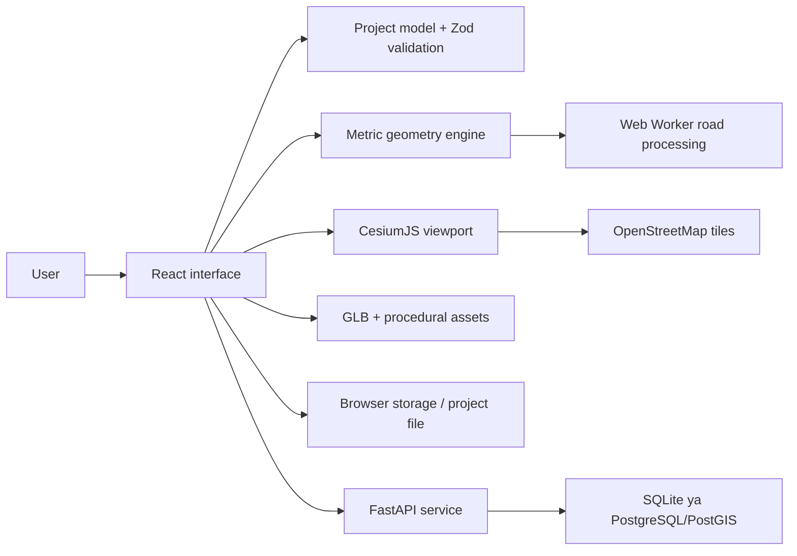

# Sitecraft Demo Guide — Roman Urdu

Yeh guide kal ke demo ke liye hai. Is mein project ka purpose, architecture, files, maps, assets, tools aur istemal ka seedha jawab diya gaya hai.

## 1. Project aik line mein

**Sitecraft aik browser-based New Zealand city planning studio hai jahan user real map ke upar site boundary, connected roads, plots, buildings aur society facilities design karta hai aur design ko 2D, 3D, Street aur Cinematic views mein dekh sakta hai.**

## 2. System ka seedha chart



**Flow:** user tool select karta hai → map par points deta hai → geometry metres mein calculate hoti hai → validation overlap/boundary check karti hai → Cesium result render karta hai → project browser, computer file ya API mein save hota hai.

## 3. Current technology stack

| Hissa             | Technology                                  | Kaam                                            |
| ----------------- | ------------------------------------------- | ----------------------------------------------- |
| Frontend          | React 19 + TypeScript                       | UI, panels, tools aur application state         |
| Build tool        | Vite 8                                      | fast development server aur production build    |
| 3D map            | CesiumJS 1.146                              | 2D/3D globe, camera aur design rendering        |
| Icons             | Lucide React                                | toolbar aur UI icons                            |
| Schema validation | Zod                                         | browser mein project JSON validate karta hai    |
| Geometry          | polygon-clipping                            | road/building surfaces aur overlap calculations |
| Coordinates       | proj4                                       | WGS84 aur NZTM2000 conversion                   |
| Tests             | Vitest + Playwright                         | unit aur real browser tests                     |
| Backend           | FastAPI + Python                            | project save/load API                           |
| Database layer    | SQLAlchemy + Alembic                        | database access aur migrations                  |
| Spatial backend   | Shapely + PyProj                            | server-side geometry validation                 |
| Database          | SQLite default; PostgreSQL/PostGIS optional | project persistence                             |

## 4. Maps aur coordinate system

| Sawal                                 | Jawab                                                                 |
| ------------------------------------- | --------------------------------------------------------------------- |
| Background map konsa hai?             | OpenStreetMap standard raster tiles                                   |
| Renderer konsa hai?                   | CesiumJS                                                              |
| Geographic format?                    | WGS84 / EPSG:4326, order longitude phir latitude                      |
| Local measurement?                    | NZTM2000 / EPSG:2193                                                  |
| Width, length aur area kis unit mein? | metre, square metre aur hectare                                       |
| Default terrain?                      | flat ellipsoid; is liye engineering elevation claim nahi hota         |
| Optional terrain?                     | Cesium World Terrain token ke zariye, lekin paid service zaroori nahi |
| Site analysis kahan se?               | OpenStreetMap Overpass endpoints aur reverse lookup                   |

Map sirf background picture nahi hai. Project ka origin WGS84 mein save hota hai, jab ke editing local east/north metre offsets mein hoti hai. Is se road width aur plot area degrees ke bajaye real metric units mein calculate hotay hain.

## 5. Asset sources aur formats

| Asset                    | Source                             | License            | Format                    |
| ------------------------ | ---------------------------------- | ------------------ | ------------------------- |
| Houses aur cars          | Kenney City Kit Suburban + Car Kit | CC0 1.0            | `.glb`                    |
| Proof trees              | Quaternius Stylized Nature MegaKit | CC0 1.0            | `.glb`                    |
| Water texture            | project asset                      | local              | `.svg`                    |
| Built-in society objects | Sitecraft procedural models        | project code       | Cesium geometry/materials |
| Custom user model        | user ki apni file                  | user responsible   | binary `.glb`, max 25 MB  |
| Map context              | OpenStreetMap                      | ODbL + tile policy | raster map tiles          |

**GLB kya hai?** GLB aik single binary 3D file hoti hai. Is mein model, material aur texture aik file mein ho saktay hain, is liye browser upload ke liye asaan hai.

Project file `.json` hoti hai. GIS exchange ke liye `.geojson` use hoti hai. GeoJSON complete backup nahi; exact editable project backup ke liye Project JSON use karna chahiye.

## 6. Main folders aur files

### Root

| File/folder              | Kaam                                        |
| ------------------------ | ------------------------------------------- |
| `package.json`           | workspace commands: dev, test, build        |
| `README.md`              | setup aur run instructions                  |
| `docs/`                  | architecture, sources, scope aur demo guide |
| `apps/web/`              | React/Cesium frontend                       |
| `apps/api/`              | FastAPI backend                             |
| `infra/`                 | PostgreSQL/PostGIS deployment setup         |
| `scripts/`               | Cesium copy aur helper scripts              |
| `sample-assets/`         | upload test ke sample assets                |
| `THIRD_PARTY_NOTICES.md` | open-source licenses aur credits            |

### Frontend ki important files

| File                               | Kaam                                                                     |
| ---------------------------------- | ------------------------------------------------------------------------ |
| `apps/web/src/main.tsx`            | React app ka entry point                                                 |
| `apps/web/src/App.tsx`             | main UI, toolbar, panels, dialogs aur user workflow                      |
| `apps/web/src/Viewport.tsx`        | Cesium viewer, rendering, camera, 2D/3D/Street/Cinematic behavior        |
| `apps/web/src/model.ts`            | project/object schema, defaults aur demo data model                      |
| `apps/web/src/geometry.ts`         | area, distance, footprints, road surfaces, snapping aur collision checks |
| `apps/web/src/geometry.worker.ts`  | heavy road geometry background thread mein banata hai                    |
| `apps/web/src/history.ts`          | undo/redo command journal                                                |
| `apps/web/src/persistence.ts`      | browser save, file save/open aur API persistence                         |
| `apps/web/src/assetStorage.ts`     | custom GLB ko browser asset library mein rakhta hai                      |
| `apps/web/src/societyAssets.ts`    | available society asset catalogue                                        |
| `apps/web/src/geojson.ts`          | GeoJSON import/export handling                                           |
| `apps/web/src/geocoding.ts`        | New Zealand location search                                              |
| `apps/web/src/siteAnalysis.ts`     | boundary ke aas paas OSM road/water/building analysis                    |
| `apps/web/src/planningAnalysis.ts` | planning checks aur calculated indicators                                |
| `apps/web/src/planningReport.ts`   | analysis/report data tayar karta hai                                     |
| `apps/web/src/zarajDemo.ts`        | Avalon Heights Rolleston demo generator                                  |
| `apps/web/src/cinematicDemo.ts`    | separate visual showcase society                                         |
| `apps/web/src/style.css`           | complete responsive UI styling                                           |

### Backend ki important files

| File                         | Kaam                                       |
| ---------------------------- | ------------------------------------------ |
| `apps/api/app/main.py`       | FastAPI routes aur application             |
| `apps/api/app/models.py`     | Pydantic request/project validation        |
| `apps/api/app/database.py`   | database connection                        |
| `apps/api/app/storage.py`    | local/S3-compatible asset storage adapters |
| `apps/api/alembic/`          | database migrations                        |
| `apps/api/tests/test_api.py` | API tests                                  |

## 7. Project ke objects

Basic design objects: boundary, road, building, plot, tree, car, bench aur bridge.

Society library mein faith, education, health, commercial, recreation, safety aur infrastructure items hain. Misal: mosque, church, temple, gurdwara, school, nursery, clinic, hospital, pharmacy, shops, supermarket, office, restaurant, community centre, library, graveyard, police, fire station, playground, sports field, theme park, public toilet, bus stop, streetlight, traffic signal, footpath, cycle lane, zebra crossing, speed breaker, divider, roundabout, bicycle rack, bin, planter, bollard, gazebo, fountain, kiosk, outdoor gym, wall, fence, gate, ramp, parking bays, water tank, transformer, solar panels aur recycling.

## 8. Toolbar ka istemal

| Tool          | Kya karta hai                                                            |
| ------------- | ------------------------------------------------------------------------ |
| Select        | object select karta hai; inspector mein settings khulti hain             |
| Hand          | map ko pan/orbit karke sirf explore karta hai                            |
| Boundary      | minimum 3 points se site banata hai; live edge aur area dikhata hai      |
| Road          | 2 ya zyada points se road banata hai; width/lanes/purpose set hota hai   |
| Building      | building place karta hai; shape, size, floors, roof, rotation aur colour |
| Plot          | polygon plot draw karta hai                                              |
| Rectangle     | rectangular shape banata hai                                             |
| Circle        | circular shape banata hai                                                |
| Free style    | custom freehand polygon banata hai                                       |
| Move          | selected object ko nayi jagah le jata hai                                |
| Frame project | poori site screen par fit karta hai                                      |
| Reset view    | top view reset karta hai                                                 |
| Undo/Redo     | current session ke last 100 commands manage karta hai                    |
| Delete        | selected object delete karta hai                                         |
| Duplicate     | inspector se object copy karta hai                                       |

Boundary ya road draw karte waqt double-click se drawing finish ho sakti hai. Right-click drawing se nikal kar Move/normal navigation workflow mein madad karta hai. `Esc` current drawing cancel karta hai.

## 9. Views

| View      | Demo mein kya bolna hai                                               |
| --------- | --------------------------------------------------------------------- |
| 2D        | master plan aur exact placement check karne ke liye top view          |
| 3D        | massing, height, roofs aur overall society dekhne ke liye perspective |
| Street    | insaan ki eye level se road aur buildings explore karne ke liye       |
| Cinematic | Entrance, Walkthrough, Landmarks aur Aerial guided camera shots       |

3D controls mein Walk, 360° aur Drone profiles hain. WASD/arrows movement ke liye; Q/E drone height ke liye. Screen buttons se forward/back, left/right, rotate aur tilt bhi ho sakta hai.

## 10. Layers aur Inspector

**Layers panel:** object categories ko show/hide karta hai, opacity change karta hai, order manage karta hai aur imported GeoJSON layers rakhta hai. Current project aur opened project layer ke objects separate hierarchy mein nazar aatay hain.

**Inspector:** selected object ka naam, coordinates, dimensions, colour, rotation, floors, roof, asset variant aur doosri relevant properties edit karta hai. Frame, move, duplicate aur delete actions bhi yahan miltay hain.

## 11. Road logic

- Road alignment ordered points aur node IDs se banti hai.
- Connected junctions same node ID share kartay hain.
- Road width metre mein hoti hai aur visible paved surface generate hoti hai.
- Internal road boundary ke andar rehti hai.
- External access road ka aik point site ke andar aur doosra bahar existing road ki taraf ja sakta hai.
- Building-road aur building-building overlaps validation se block hotay hain.
- Gate ko access road ke upar span karna allowed hai kyun ke woh gate ka intended behavior hai.
- Current Avalon Heights demo mein Main Boulevard, Central Avenue, Park Avenue, collectors, residential streets, connected entry aur secondary exit hain.

## 12. Boundary aur site analysis

Boundary draw hote waqt har point dot ki surat mein dikhta hai. Current edge length aur area real time update hota hai. Area New Zealand style mein `m²` ya `ha` mein show hota hai.

Boundary complete hone ke baad site analysis:

- local area, size aur perimeter calculate karta hai;
- OSM live response aaye to nearby roads, buildings, water aur land use check karta hai;
- network unavailable ho to **Unknown / Not checked** dikhata hai, zero ka jhoota claim nahi karta;
- lake/water ya unsuitable context ko design se pehle flag karta hai;
- final engineering ya legal approval claim nahi karta.

## 13. Save, open aur file behavior

| Option           | Behavior                                                                   |
| ---------------- | -------------------------------------------------------------------------- |
| This browser     | project `localStorage` mein save hota hai; same browser/device tak limited |
| Save to computer | portable Project JSON save hoti hai                                        |
| Open file        | computer wali Project JSON exact origin aur objects ke sath khulti hai     |
| Local API server | FastAPI database mein revision ke sath save hota hai                       |
| Import GeoJSON   | GIS reference data separate layer ke taur par add hota hai                 |
| Export GeoJSON   | geometry exchange; complete parametric backup nahi                         |

File se khola project dobara computer file destination ke mutabiq save hota hai. Browser project browser storage mein save hota hai. Same site project kholte waqt app save/open separately/add as project layer ke options deti hai.

## 14. Validation aur limits

- Har object Zod aur backend par Pydantic validation se guzarta hai.
- Boundary minimum 3 points; road minimum 2 points.
- Object apni selected site boundary aur allowed size rules follow karta hai.
- Building/road overlaps user-friendly toaster mein show hotay hain.
- Maximum project guard: 2,000 objects.
- Maximum vertices per object: 500.
- Project JSON import: 5 MB guard.
- Custom GLB upload: 25 MB guard.
- Toast messages 2 seconds ke baad hide hotay hain.

Yeh concept planning software hai; cadastral ownership, structural approval, drainage design ya survey-grade elevation ka replacement nahi.

## 15. Project run karna

Frontend:

```powershell
cd "D:\Site Craft City Planning Studio"
npm install
npm run dev
```

Browser mein `http://127.0.0.1:5173` kholen.

Optional API:

```powershell
cd "D:\Site Craft City Planning Studio\apps\api"
.venv\Scripts\python.exe -m pip install -r requirements.lock
.venv\Scripts\python.exe -m alembic upgrade head
.venv\Scripts\python.exe -m uvicorn app.main:app --host 127.0.0.1 --port 8000
```

API docs: `http://127.0.0.1:8000/docs`

## 16. Kal ka recommended demo sequence

1. **Open app:** “Yeh Sitecraft New Zealand context mein browser-based city planning studio hai.”
2. **Avalon Heights:** Avalon Heights demo open karen aur Frame project press karen.
3. **2D:** connected road hierarchy, entry/exit, plots, parking, faith aur civic facilities dikhayen.
4. **Layers:** road/building/tree layers hide/show aur opacity change karen.
5. **Select house:** Inspector se dimensions, floors, colour aur rotation dikhayen.
6. **Boundary:** chhoti test site draw karke live metres aur hectares dikhayen.
7. **Road:** internal road aur External access road ka farq batayen.
8. **Asset:** tree/car ya society facility place karke visual variant dialog dikhayen.
9. **3D:** heights aur city massing dikhayen.
10. **Street/360:** road level movement aur controls dikhayen.
11. **Cinematic:** Entrance, Walkthrough, Landmarks aur Aerial presets chalayein.
12. **Save:** browser save aur portable project file ka farq batayen.

## 17. A se Z quick revision

| Letter | Yaad rakhne wali baat                                         |
| ------ | ------------------------------------------------------------- |
| A      | Assets: built-in, Kenney, Quaternius aur custom GLB           |
| B      | Boundary: site ki measurable limit                            |
| C      | CesiumJS: map aur 3D rendering engine                         |
| D      | Data: project JSON authoritative editable format              |
| E      | Entry/Exit: external access roads existing road direction tak |
| F      | FastAPI: optional backend service                             |
| G      | GeoJSON: GIS layer exchange format                            |
| H      | History: 100 session undo/redo commands                       |
| I      | Inspector: selected object ki properties                      |
| J      | Junction: shared road node se real graph connection           |
| K      | Kenney: CC0 houses aur cars                                   |
| L      | Layers: visibility, opacity aur categories                    |
| M      | Map: OpenStreetMap context                                    |
| N      | NZTM2000: metre-based New Zealand editing CRS                 |
| O      | Overpass: OSM site context analysis                           |
| P      | proj4/polygon-clipping: projection aur geometry operations    |
| Q      | Quality: unit tests, build aur browser tests                  |
| R      | React: interface framework                                    |
| S      | Save: browser, computer file ya API                           |
| T      | TypeScript: safer frontend code                               |
| U      | Upload: custom binary GLB asset                               |
| V      | Views: 2D, 3D, Street, Cinematic                              |
| W      | Web Worker: road geometry background mein process karta hai   |
| X      | X/Y local coordinates: east/north metre offsets               |
| Y      | Your project origin: WGS84 longitude/latitude                 |
| Z      | Zod: browser schema validation                                |

## 18. Agar koi mushkil sawal poochay

**Kya yeh engineering approved design deta hai?**  
Nahi. Yeh concept planning aur visualization tool hai. Final construction ke liye survey, planning rules aur civil/structural engineering required hain.

**Kya map paid hai?**  
Current default OpenStreetMap aur bundled CC0 assets free/open-source context use kartay hain. Optional Cesium ion terrain alag service ho sakti hai; core demo us ke baghair chalta hai.

**Kya measurement image ke pixels se hoti hai?**  
Nahi. Coordinates NZTM2000 mein convert hotay hain aur metre-based geometry calculate hoti hai.

**Kya roads sirf visually touch karti hain?**  
Nahi. Proper connected roads shared node IDs rakhti hain. Avalon Heights demo ke road graph ka automated connectivity test hai.

**Site analysis mein zero ka kya matlab hai?**  
Verified result ho to zero ka matlab OSM query mein feature nahi mila. Query fail ho to app Unknown/Not checked dikhati hai.

**Custom asset kaise add hota hai?**  
Asset Library mein Import 3D Asset kholen, `.glb` choose karen, naam/category/dimensions dein aur Add to library press karen. File browser storage mein rehti hai.

**Kya Avalon Heights kisi existing society ki copy hai?**  
Nahi. Yeh aik original conceptual New Zealand layout hai; Google ya kisi commercial planner ka code/design copy nahi.
